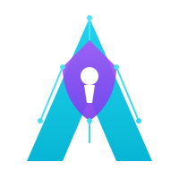
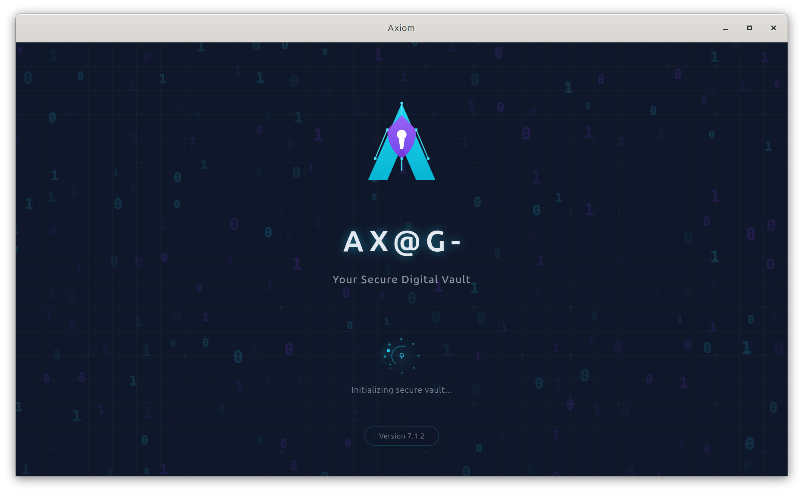
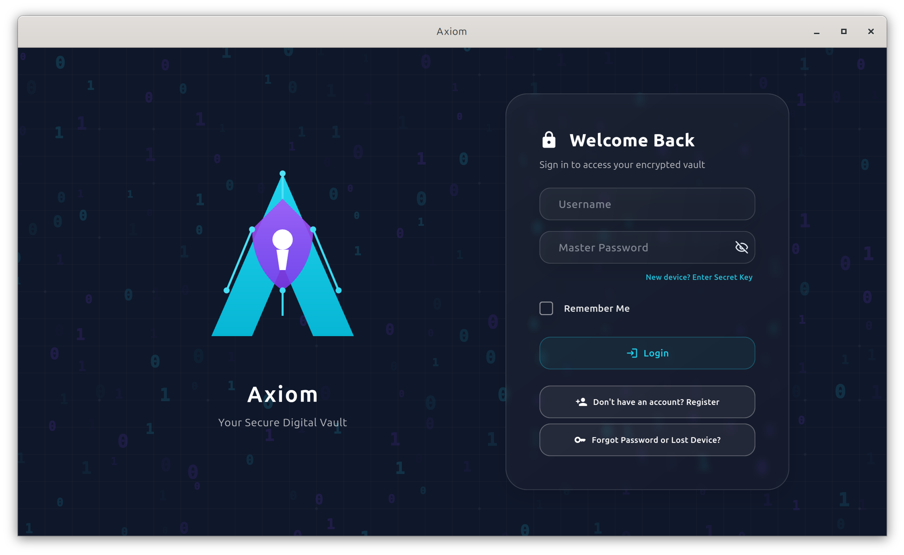
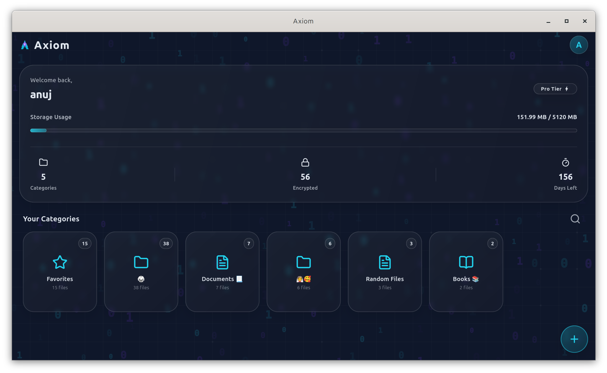
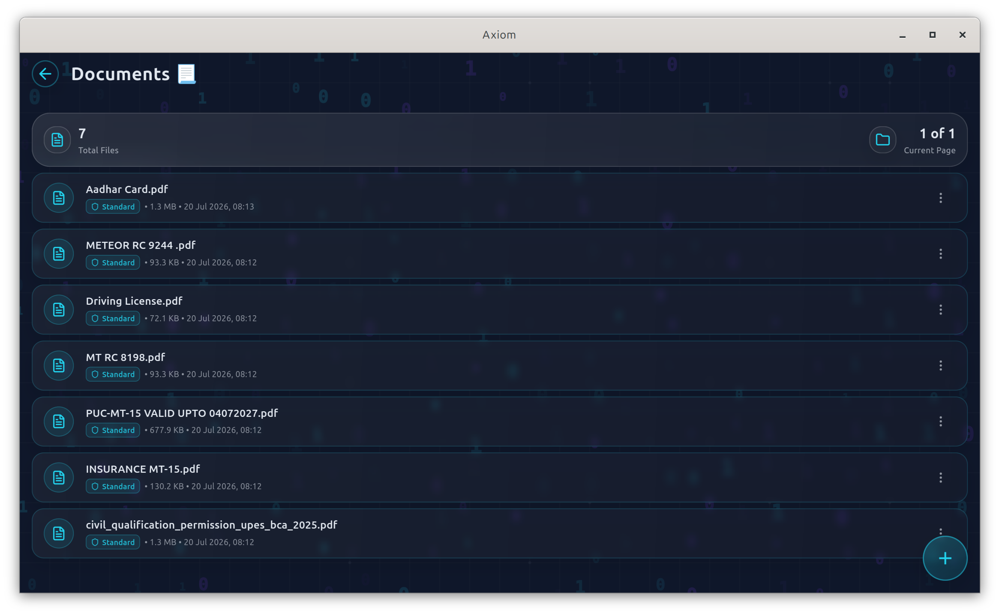
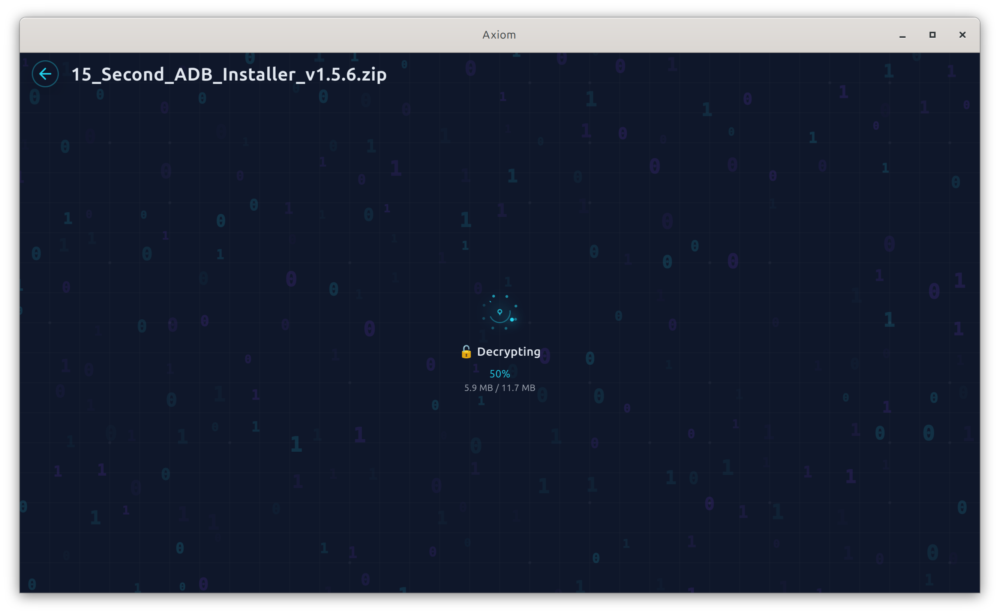
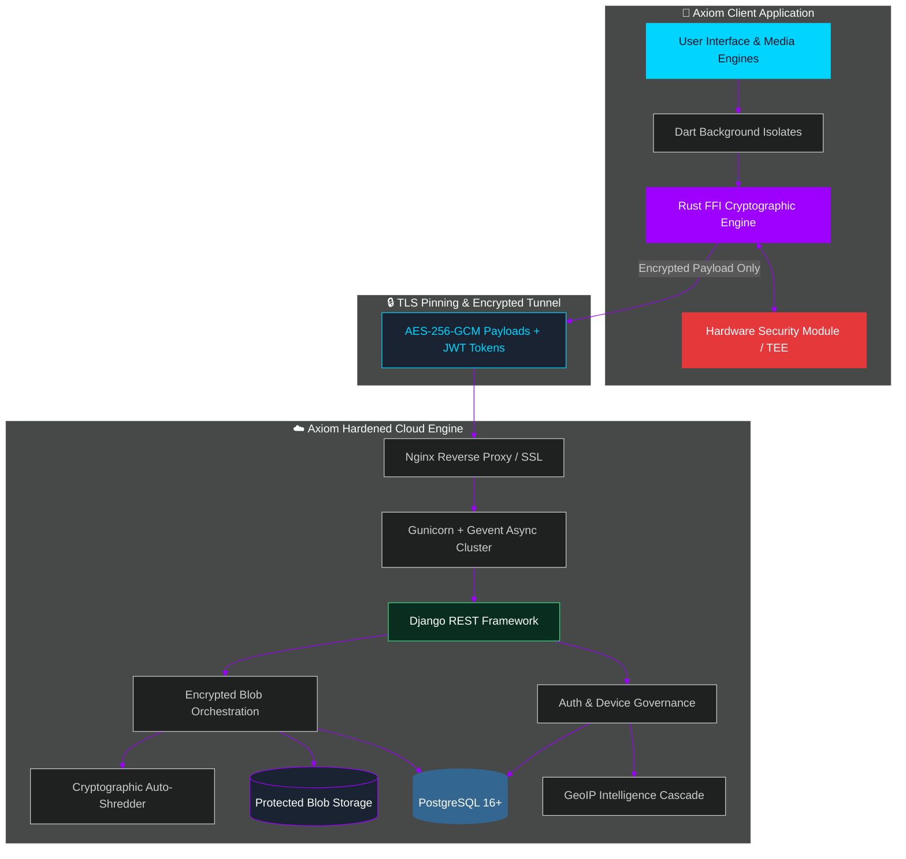

<div align="center">



<br>

# A X I O M

### Enterprise Zero-Knowledge Vault & Cloud Security Ecosystem

<sub>Cross-Platform Native Vault Application · Hardened API Cloud Engine · Military-Grade Cryptography</sub>

<br>

[](https://flutter.dev)
[](https://dart.dev)
[](https://www.rust-lang.org)
[](https://www.djangoproject.com)
[](https://www.django-rest-framework.org)
[](https://www.postgresql.org)
[](pubspec.yaml)
[](LICENSE)

<br>


</div>

<br>

---

<br>

## 🌐 Executive Overview

**Axiom** is a complete, unified security ecosystem engineered for individuals, executives, and enterprises who demand uncompromising privacy. The system combines a **high-performance cross-platform client app** with a **hardened, zero-knowledge cloud backend**.

Unlike conventional cloud platforms, Axiom enforces a strict **Zero-Knowledge Architecture**:
- All data is encrypted locally on the user's physical hardware **before** transmission.
- Cryptographic keys never leave the host device.
- The cloud backend processes and stores only opaque, unreadable blobs.
- Even in the event of an infrastructure-wide server breach, stored data remains mathematically impenetrable.

<br>

<div align="center">

### 📸 Application Interface

<table>
<tr>
<td width="50%" align="center">

<br>
<sub><b>Branded Launch Experience</b></sub>
</td>
<td width="50%" align="center">

<br>
<sub><b>Hardware-Bound Authentication</b></sub>
</td>
</tr>
<tr>
<td width="50%" align="center">

<br>
<sub><b>Interactive Vault Dashboard</b></sub>
</td>
<td width="50%" align="center">

<br>
<sub><b>Encrypted File Manager</b></sub>
</td>
</tr>
<tr>
<td colspan="2" align="center">

<br>
<sub><b>Real-Time Cryptographic Streaming & Processing</b></sub>
</td>
</tr>
</table>

</div>

<br>

---

<br>

## 🏛️ System Architecture

The following diagram illustrates the end-to-end zero-knowledge flow between the client runtime and the cloud infrastructure:



<br>

---

<br>

## ✨ Complete Feature Matrix

<table>
<tr>
<th width="50%">📱 Client Application Capabilities</th>
<th width="50%">⚙️ Cloud Backend & Server Capabilities</th>
</tr>
<tr>
<td valign="top">

### 🔐 Multi-Tier Security
- **AES-256-GCM** authenticated encryption with unique random IV per file.
- **4 Security Tiers**: Software Standard, Hardware Envelope (cross-device), Device-Locked (hardware bound), and True Hardware (TEE-confined).
- **Argon2id Native Key Derivation**: High-memory, brute-force resistant key generation via native Rust FFI.
- **Envelope Encryption**: Files protected by transient payload keys wrapped inside hardware chip master keys.
- **Hardware Integration**: Android StrongBox, ARM TrustZone, Apple Secure Enclave, and Windows/Linux TPM 2.0.
- **Runtime Threat Defense**: Integrated freeRASP detection against root/jailbreak, debuggers, hooking frameworks, and emulators.
- **Self-Destruct**: Emergency panic password triggers cryptographic data purge.
- **Secret Key Rotation & Account Recovery**: Re-wrap file keys and recover accounts safely without master passwords touching servers.

### 📁 Advanced File Management
- **Universal File Support**: Transparently encrypts images, 4K videos, documents, audio, archives, and executables.
- **Hybrid I/O Engine**: RAM-only processing for small files (<50 MB) and chunked isolate streaming for massive files (>50 MB).
- **In-App Encrypted Players**: Direct streaming decryption for audio/video; native PDF viewer without disk caching.
- **Desktop & Mobile Workflow**: Drag-and-drop on desktop, native system tray, background isolate operations, and OS share-intent handlers.
- **Organized Vaults**: Nested categories, favorites, metadata tags, encrypted file notes, and date-aware search.

### 📷 Encrypted Camera & AI Scanner
- **Zero-Disk Camera**: Captures photos/videos directly to encrypted memory buffers.
- **On-Device AI Document Detection**: Real-time TFLite edge detection model.
- **Perspective Correction**: Native Rust image transformations.
- **Batch Export**: Instant aggregation into encrypted PDFs or ZIP bundles.

</td>
<td valign="top">

### 🛡️ Zero-Knowledge Storage Engine
- **Opaque Blob Storage**: The backend strictly manages encrypted byte streams without key visibility.
- **Cryptographic File Shredding**: Secure multi-pass random overwrite and `fsync` before file unlinking.
- **Deferred Shred Queue**: Asynchronous background cleanup guaranteeing sub-100ms API response times.
- **Orphan File Sweep**: Automated background cleaner eliminates unreferenced storage artifacts.

### 🔑 Identity & Device Governance
- **JWT Authentication**: Short-lived tokens with automated rotation and cryptographically signed session verification.
- **Device Authorization Matrix**: Enforces per-account hardware device limits with remote session revocation and blacklisting.
- **Sliding-Window Brute-Force Lockout**: Intelligent threshold protection against automated credential stuffing.
- **Resilient GeoIP Intelligence**: 4-layer cascade (`ipwho.is` HTTPS primary, `ip-api.com`, `freeipapi.com`, and offline GeoLite2 database) for accurate audit trails without service disruptions.
- **User-Initiated Emergency Lock**: Immediate freeze of account endpoints upon suspected compromise.

### 💳 Subscriptions & Monetization
- **Dynamic Tier Management**: Instant administrative control over quotas, file size thresholds, and device allowances.
- **Enterprise Payment Integrations**: Webhook verification and automated lifecycle updates.
- **Additive Renewals**: Early renewals preserve all unconsumed subscription duration.
- **Grace Period & Data Retention**: Configurable read-only access windows transitioning to hard-lock retention schedules before automatic account purging.

</td>
</tr>
</table>

<br>

---

<br>

## 🔒 Cryptographic Specifications

```
                     ┌────────────────────────────────────────┐
                     │          Plaintext Source File         │
                     └───────────────────┬────────────────────┘
                                         │
                         ┌───────────────▼───────────────┐
                         │   Random 96-bit IV Generated   │
                         └───────────────┬───────────────┘
                                         │
        ┌────────────────────────────────┼────────────────────────────────┐
        │                                │                                │
┌───────▼────────┐               ┌───────▼────────┐               ┌───────▼────────┐
│  Tier 1: Std   │               │ Tier 2: Envel  │               │ Tier 3/4: Dev  │
│ User Passphrase│               │ Hardware Wrap  │               │ TEE/TPM Bound  │
│ + Argon2id Key │               │ Cross-Device   │               │ Hardware Chip  │
└───────┬────────┘               └───────┬────────┘               └───────┬────────┘
        │                                │                                │
        └────────────────────────────────┼────────────────────────────────┘
                                         │
                         ┌───────────────▼───────────────┐
                         │   AES-256-GCM Native Engine   │
                         └───────────────┬───────────────┘
                                         │
                         ┌───────────────▼───────────────┐
                         │ Encrypted Blob + 128-bit Tag  │
                         └───────────────┬───────────────┘
                                         │
                         ┌───────────────▼───────────────┐
                         │  Streamed to Axiom Cloud API  │
                         └───────────────────────────────┘
```

| Dimension | Specification | Implementation Detail |
|:----------|:--------------|:----------------------|
| **Symmetric Encryption** | AES-256-GCM | Authenticated Galois/Counter Mode with 128-bit authentication tag |
| **Key Derivation** | Argon2id | Memory-hard password hashing implemented in native Rust FFI |
| **Initialization Vector** | Cryptographically Random | Unique 96-bit IV generated per file and chunk |
| **Envelope Encryption** | Key Encapsulation (KEM) | Per-file symmetric keys encrypted with hardware-bound master keys |
| **Hardware Key Storage** | Platform Enclave | StrongBox (Android), Secure Enclave (Apple), TPM 2.0 (Windows/Linux) |
| **Data Deletion** | Secure Shredding | Random overwrite + filesystem sync prior to inode deletion |
| **API Transport** | TLS 1.3 Pinning | Encrypted transport channel terminating at reverse proxy |
| **Server Key Access** | Strict Zero-Knowledge | Zero server visibility into keys, passphrases, or plaintexts |

<br>

---

<br>

## 🛠️ Full-Stack Technology Suite

<table>
<tr>
<th width="50%">Client Application Stack</th>
<th width="50%">Backend & Infrastructure Stack</th>
</tr>
<tr>
<td valign="top">

- **Framework**: [Flutter 3.29+](https://flutter.dev) & [Dart 3.9+](https://dart.dev)
- **State Management**: [Riverpod](https://riverpod.dev) reactive architecture
- **Cryptography Engine**: Native [Rust](https://www.rust-lang.org) FFI + PointyCastle
- **Key Derivation**: Rust-native Argon2id
- **Hardware Security**: Platform Secure Enclave & Keystore bindings
- **Audio/Video Decoder**: Native hardware-accelerated MediaKit
- **Document Rendering**: Syncfusion Encrypted PDF Engine
- **Computer Vision**: On-device [TensorFlow Lite](https://www.tensorflow.org/lite)
- **Runtime Integrity**: freeRASP threat detection engine
- **Concurrency**: Dart Multithreaded Background Isolates

</td>
<td valign="top">

- **Framework**: [Django 5.2+](https://www.djangoproject.com)
- **API Framework**: [Django REST Framework 3.16+](https://www.django-rest-framework.org)
- **Primary Database**: [PostgreSQL 16+](https://www.postgresql.org)
- **Token Security**: SimpleJWT with cryptographic rotation
- **WSGI / Async**: Gunicorn + Gevent High-Concurrency Worker Pool
- **Reverse Proxy**: Nginx with HTTP/2 and automated SSL
- **Geolocation Engine**: 4-Tier Cascade (`ipwho.is` → `ip-api` → `freeipapi` → MaxMind GeoLite2)
- **Monetization Engine**: Webhook-verified payment gateway handlers
- **Maintenance Suite**: Shell & PowerShell database management tools

</td>
</tr>
</table>

<br>

---

<br>

## 🚀 Deployment & Operations

### Cloud Backend Deployment

The backend is built with enterprise deployment in mind, including automated database provisioning scripts.

```bash
# 1. Clone repository
git clone https://github.com/himanshuchaurasiya24/axiom_backend.git
cd axiom_backend

# 2. Initialize environment & dependencies
python3 -m venv venv
source venv/bin/activate
pip install -r requirements.txt

# 3. Configure environment variables (.env)
cp .env.example .env

# 4. Provision Database (Automated setup)
bash ./scripts/setup_database.sh

# 5. Launch Production WSGI Server
gunicorn axiomcore.wsgi:application -k gevent -w 4 -b 0.0.0.0:8000
```

### Client Application Build

```bash
# 1. Clone repository
git clone https://github.com/himanshuchaurasiya24/axiom.git
cd axiom

# 2. Fetch Flutter packages
flutter pub get

# 3. Build target platform (e.g., Desktop or Mobile)
flutter build apk --release       # Android
flutter build ipa --release       # iOS
flutter build windows --release   # Windows
flutter build linux --release     # Linux
flutter build macos --release     # macOS
```

<br>

---

<br>

## 🗄️ Enterprise Database Management Suite

Axiom Backend includes a console-based database administration suite:

| Operation | Method | Enterprise Guarantee |
|:----------|:-------|:---------------------|
| **Automated Backup** | Dump with sequential rotation | Creates standalone, compressed `.dump` files ready for cold storage |
| **Schema Restore** | Clean restore | Drops target schema and performs deterministic restore from snapshot |
| **Smart Non-Destructive Merge** | Staged conflict resolution | Uses temporary staging databases and `ON CONFLICT DO NOTHING` to merge data without overwriting live user records |

```bash
# Launch interactive database manager
bash ./scripts/database/db_manager.sh        # Linux/macOS
& .\scripts\database\db_manager.ps1          # Windows PowerShell
```

<br>

---

<br>

## ⚡ Performance Metrics

| Metric | Client App | Backend Engine |
|:-------|:-----------|:---------------|
| **Memory Footprint** | Dynamic memory bounds (<120 MB idle) | Efficient streaming buffers (<5 MB chunk size) |
| **Small File Processing** | RAM-only encryption with zero disk I/O | Direct memory-to-disk streaming |
| **Large File Processing** | Unlimited size via 5 MB chunk streaming | Resumable chunk pipeline |
| **UI Responsiveness** | Strict 60 FPS guaranteed via background worker Isolates | Sub-50ms API request latency |
| **Deletion Latency** | Non-blocking (immediate UI acknowledgement) | Deferred shred queue with background worker execution |

<br>

---

<br>

## 🗺️ Product Roadmap

<table>
<tr>
<td align="center" width="33%">

### Phase 1 ✅
**Foundational Ecosystem**

```
✓ Cross-platform native clients
✓ 4-Tier security model
✓ Hardware chip key integration
✓ Zero-knowledge cloud engine
✓ AI document scanner
✓ Real-time background workers
✓ Custom themes & glassmorphic UI
```

</td>
<td align="center" width="33%">

### Phase 2 🔄
**Secure Collaboration**

```
→ Zero-knowledge file sharing
→ Ephemeral time-limited links
→ Multi-tenant organizational vaults
→ Granular role-based permissions
→ Hardware-authenticated signing
```

</td>
<td align="center" width="33%">

### Phase 3 🔮
**Enterprise & Edge**

```
→ WebAssembly PWA client
→ Client-side browser crypto
→ Encrypted full-text indexing
→ Dedicated enterprise self-hosting
→ Automated compliance audits
```

</td>
</tr>
</table>

<br>

---

<br>

## 🔐 Privacy & Integrity Guarantees

<table>
<tr>
<td align="center" width="25%">
<h3>🚫</h3>
<b>Absolute Zero Knowledge</b>
<br>
<sub>Files arrive encrypted. We cannot inspect or reconstruct user data under any circumstance.</sub>
</td>
<td align="center" width="25%">
<h3>🚫</h3>
<b>Zero Telemetry Tracking</b>
<br>
<sub>No user profiling, third-party analytics, behavioral trackers, or data-collection SDKs.</sub>
</td>
<td align="center" width="25%">
<h3>🔒</h3>
<b>Local Key Containment</b>
<br>
<sub>Cryptographic master keys remain isolated inside local device secure hardware chips.</sub>
</td>
<td align="center" width="25%">
<h3>🛡️</h3>
<b>Cryptographic Shredding</b>
<br>
<sub>Deleted files undergo random block overwriting and disk sync before deletion.</sub>
</td>
</tr>
</table>

<br>

---

<br>

## 📞 Inquiries & Licensing

<div align="center">

[](mailto:himanshuchaurasiya24@gmail.com)
[](https://github.com/himanshuchaurasiya24)

</div>

<br>

```
Copyright © 2026 Himanshu Chaurasiya. All Rights Reserved.

PROPRIETARY SOFTWARE NOTICE:
This codebase, design, and cryptographic workflows constitute proprietary property.
Unauthorized copying, duplication, decompilation, distribution, reverse-engineering,
or commercial exploitation is strictly prohibited without explicit written authorization.
```

<br>

<div align="center">


<br>

<sub>

**A X I O M** — Military-Grade Zero-Knowledge Privacy Ecosystem

Engineered by [Himanshu Chaurasiya](https://github.com/himanshuchaurasiya24)

</sub>

</div>
